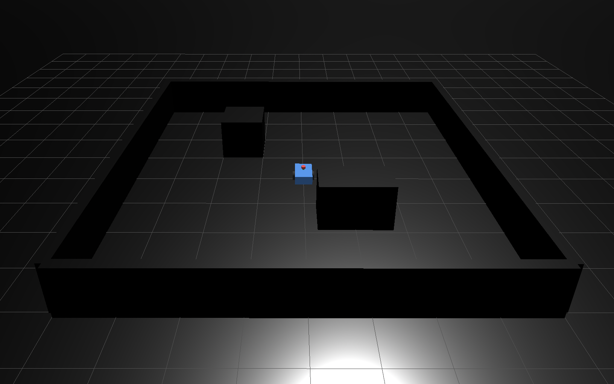
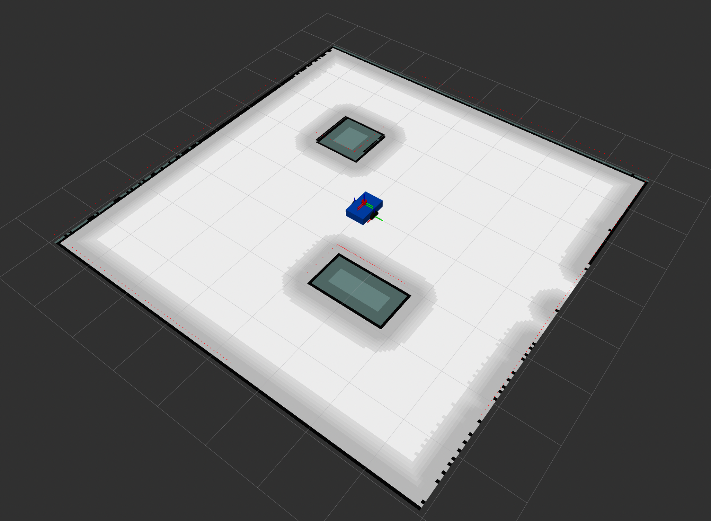
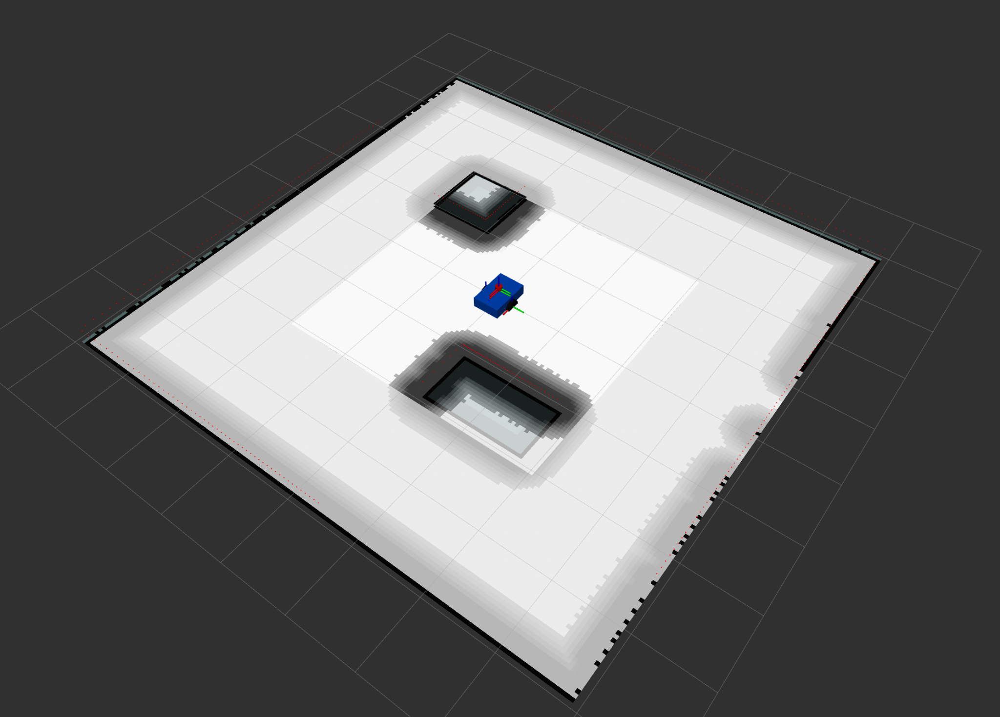
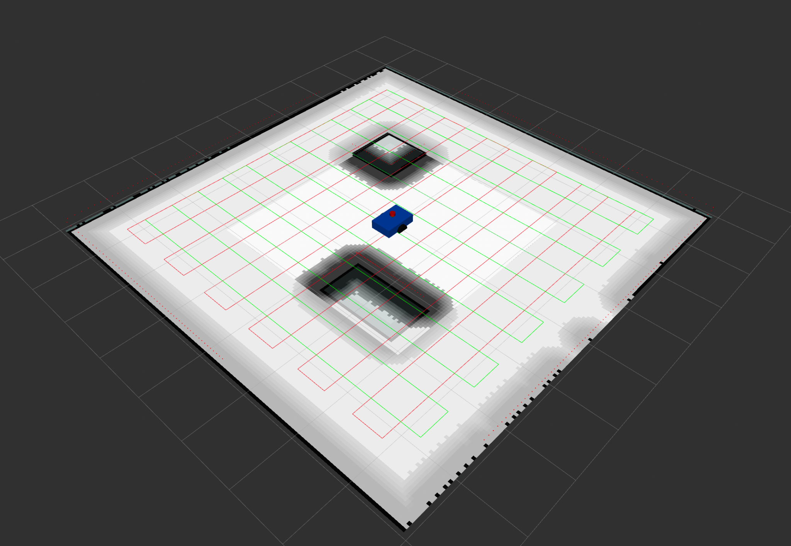

# ROS 2 Autonomous Lawn Mower

A complete autonomous differential-drive mobile robot project built with **ROS 2 Jazzy**, **Gazebo Harmonic**, **Simultaneous Localization and Mapping - SLAM Toolbox**, **robot_localization**, **Adaptive Monte Carlo Localization - AMCL**, and **Nav2**.

The project was developed from the robot model upward: simulation, sensor integration, custom ROS 2 nodes, localization, mapping, autonomous navigation, and finally a crosshatch lawn-mower coverage mission.


## Project Overview

The goal of this project is to build an autonomous mobile robot capable of:

- simulating realistic differential-drive motion
- perceiving obstacles using a 2D LiDAR
- estimating robot motion
- building a map of an unknown environment
- localizing itself inside a saved map
- planning collision-free paths
- autonomously navigating to goals
- performing systematic area coverage similar to an autonomous lawn mower

The project combines standard ROS 2 navigation components with custom ROS 2 nodes developed for obstacle avoidance, LiDAR processing, and area coverage.


## System Architecture

```text
                         +----------------------+
                         |      Gazebo Sim      |
                         | robot + world + lidar|
                         +----------+-----------+
                                    |
                              ros_gz_bridge
                                    |
             +----------------------+----------------------+
             |                      |                      |
           /scan                  /odom                 /cmd_vel
             |                      |                      ^
             |                      v                      |
             |              robot_localization             |
             |                    EKF                      |
             |                      |                      |
             |               odom -> base_link             |
             |                      |                      |
             +----------+-----------+----------------------+
                        |
               +--------+---------+
               |                  |
          SLAM Toolbox           AMCL
          map creation       map -> odom
                                  |
                                  v
                                Nav2
                    planner + controller + costmaps
                                  |
                         NavigateThroughPoses
                                  |
                          lawn_mower node
```

## Screenshots

### Gazebo simulation environment



### Saved map, localization, and Nav2



### Nav2 costmaps and obstacle inflation



### Crosshatch coverage plan

The coverage extension performs a vertical serpentine sweep followed by a horizontal serpentine sweep. Nav2 is responsible for safe motion around the internal obstacles.



## Repository Structure

```text
ros2-autonomous-lawn-mower/
├── README.md
├── GITHUB_UPLOAD.md
├── .gitignore
├── screenshots/
└── src/
    ├── robot_description/
    │   ├── config/
    │   │   ├── amcl.yaml
    │   │   ├── bridge.yaml
    │   │   ├── ekf.yaml
    │   │   ├── nav2.yaml
    │   │   └── slam.yaml
    │   ├── launch/
    │   │   ├── amcl.launch.py
    │   │   ├── bringup.launch.py
    │   │   ├── display.launch.py
    │   │   ├── ekf.launch.py
    │   │   ├── nav2.launch.py
    │   │   └── simulation.launch.py
    │   ├── maps/
    │   │   ├── test_map.pgm
    │   │   └── test_map.yaml
    │   ├── rviz/
    │   │   └── navigation.rviz
    │   ├── urdf/
    │   │   ├── robot.urdf
    │   │   └── robot.urdf.xacro
    │   └── worlds/
    │       └── test_world.sdf
    └── robot_control/
        └── robot_control/
            ├── lawn_mower.py
            ├── obstacle_avoider.py
            └── scan_reader.py
```

## Tested Environment

- Ubuntu 24.04
- ROS 2 Jazzy
- Gazebo Harmonic

The project was developed using software rendering for Gazebo on the development machine:

```bash
LIBGL_ALWAYS_SOFTWARE=1
```

The integrated bringup launch sets this environment variable automatically.

## Install Dependencies

Install ROS 2 Jazzy and Gazebo Harmonic first, then install the main packages used by this project:

```bash
sudo apt update
sudo apt install -y \
  ros-jazzy-ros-gz \
  ros-jazzy-xacro \
  ros-jazzy-robot-state-publisher \
  ros-jazzy-joint-state-publisher-gui \
  ros-jazzy-rviz2 \
  ros-jazzy-robot-localization \
  ros-jazzy-slam-toolbox \
  ros-jazzy-navigation2 \
  ros-jazzy-nav2-bringup
```

## Build

Clone the repository into a workspace or use the repository itself as the workspace root:

```bash
git clone https://github.com/BesherTaye/ros2-autonomous-lawn-mower.git
cd ros2-autonomous-lawn-mower

source /opt/ros/jazzy/setup.bash
colcon build
source install/setup.bash
```

## Run the Full Autonomous Stack

The integrated bringup starts Gazebo, the bridge, Extended Kalman Filter (EKF), map server + AMCL, Nav2, and RViz with timed startup ordering:

```bash
source /opt/ros/jazzy/setup.bash
source install/setup.bash
ros2 launch robot_description bringup.launch.py
```

Wait for the lifecycle nodes to become active:

```bash
ros2 lifecycle get /amcl
ros2 lifecycle get /controller_server
ros2 lifecycle get /planner_server
ros2 lifecycle get /bt_navigator
```

Expected state:

```text
active [3]
```

## Run Crosshatch Lawn-Mower Coverage

After the full autonomy stack is running:

```bash
source install/setup.bash
ros2 run robot_control lawn_mower
```
This project uses a 
> Boustrophedon-inspired serpentine coverage pattern**

but it does **not currently implement full Boustrophedon Cellular Decomposition**.

The robot follows regularly spaced parallel sweep lanes across the map. The direction alternates between neighboring lanes.

The coverage node sends two `NavigateThroughPoses` missions:

1. Vertical serpentine coverage
2. Horizontal serpentine coverage

It also publishes:

```text
/vertical_coverage_path
/horizontal_coverage_path
/actual_path
```

These can be visualized with RViz `Path` displays.

For the intended coverage paths, use **Transient Local** durability in RViz.

## Other Custom Nodes

### Laser scan reader

```bash
ros2 run robot_control scan_reader
```

### Custom obstacle avoidance

```bash
ros2 run robot_control obstacle_avoider
```

Do not run the custom obstacle-avoidance node at the same time as Nav2, because both can publish velocity commands.

## Mapping Workflow

For creating a new map, run simulation + bridge + EKF and then SLAM Toolbox with the included configuration:

```bash
ros2 launch slam_toolbox online_async_launch.py \
  slam_params_file:=$(ros2 pkg prefix robot_description)/share/robot_description/config/slam.yaml \
  use_sim_time:=true
```

After exploring the environment, save the map with Nav2 map saver:

```bash
ros2 run nav2_map_server map_saver_cli -f test_map
```

The repository already includes the map used by the AMCL launch.

## TF Architecture

During localization and navigation, frame ownership is:

```text
map
 ↓  AMCL
odom
 ↓  EKF
base_link
 ├── lidar_link
 ├── imu_link
 ├── left_wheel
 ├── right_wheel
 ├── front_caster_link
 └── rear_caster_link
```

## Notes

- The project intentionally uses `base_link` directly; there is no `base_footprint` frame.
- RViz `/map` display should use **Transient Local** durability.
- RViz `/scan` display should use **Best Effort** reliability.
- The custom lawn-mower coverage area and lane spacing can be changed in `robot_control/lawn_mower.py`.
- Generated `build/`, `install/`, and `log/` directories are excluded from Git.

## Future Extensions

- True free-space coverage decomposition around obstacles
- Dynamic obstacle experiments
- Mission-level waypoint scheduling
- Custom Nav2 behavior-tree nodes
- Improved sensor fusion
- Autoware-oriented architecture and vehicle-scale autonomy

## License

A license has not been selected yet. Before publishing publicly, choose a license and replace the `TODO` license entries in both ROS package manifests.
