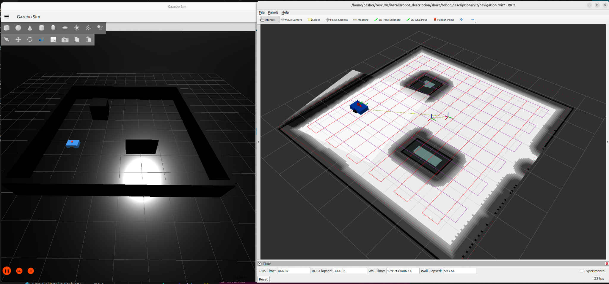

# ROS 2 Autonomous Lawn Mower

A complete autonomous differential-drive mobile robot project built with **ROS 2 Jazzy**, **Gazebo Harmonic**, **SLAM Toolbox**, **robot_localization**, **AMCL**, and **Nav2**.

The project was developed from the robot model upward: simulation, sensor integration, custom ROS 2 nodes, mapping, localization, autonomous navigation, and finally a **Boustrophedon-inspired crosshatch lawn-mower coverage mission**.



---

## Project Overview

The goal of this project is to build an autonomous mobile robot capable of:

- simulating realistic differential-drive motion,
- perceiving obstacles using a 2D/3D LiDAR,
- estimating its motion,
- building a map of an unknown environment,
- localizing itself inside a saved map,
- planning collision-free paths,
- autonomously navigating to goals,
- and performing systematic area coverage similar to an autonomous lawn mower.

The project combines standard ROS 2 navigation components with custom ROS 2 nodes developed specifically for obstacle avoidance and coverage behavior.

---

## Features

- Differential-drive mobile robot modeled in URDF/Xacro
- Gazebo Harmonic simulation with a custom test environment
- 2D GPU LiDAR and IMU integration
- ROS ↔ Gazebo communication using `ros_gz_bridge`
- Custom LaserScan processing node
- Custom finite-state-machine obstacle avoidance node
- EKF-based odometry using `robot_localization`
- SLAM Toolbox mapping
- Saved occupancy-grid map
- AMCL probabilistic localization
- Nav2 global planning and local control
- Global and local costmaps
- Obstacle inflation for collision-safe planning
- Autonomous point-to-point navigation from RViz
- Boustrophedon-inspired serpentine coverage
- Two-pass crosshatch coverage
- `NavigateThroughPoses` mission execution
- Intended coverage-path visualization
- Actual robot trajectory visualization
- Integrated autonomous-system bringup

---

# Core Concepts

## What is SLAM?

**SLAM** stands for **Simultaneous Localization and Mapping**.

A robot operating in an unknown environment initially does not know:

1. what the environment looks like, or
2. where it is inside that environment.

SLAM attempts to solve both problems simultaneously.

In this project, **SLAM Toolbox** uses:

- LiDAR measurements,
- wheel odometry,
- robot motion estimates,
- and the ROS TF tree

to construct a 2D occupancy-grid map.

The resulting map identifies:

- free space,
- occupied space,
- walls,
- obstacles,
- and unexplored regions.

The generated map is later saved and used for localization and autonomous navigation.

---

## What is AMCL?

**AMCL** stands for **Adaptive Monte Carlo Localization**.

Once a map has already been created, the robot no longer needs to perform SLAM during normal navigation.

Instead, it needs to determine:

> "Where am I inside this known map?"

AMCL solves this problem using a **particle filter**.

Each particle represents a possible estimate of the robot's pose:

```text
x position
y position
orientation
